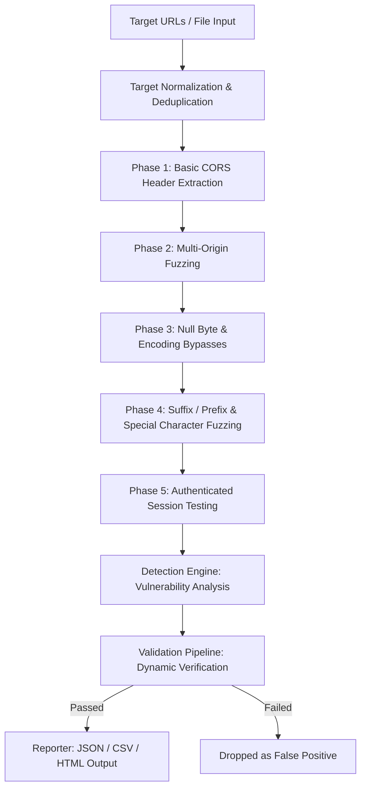

# OriginStrike ⚡

OriginStrike is a high-performance, concurrent CORS vulnerability scanner and exploitation suite designed for security researchers, penetration testers, and bug hunters. It features a robust multi-origin payload fuzzing engine, null-byte injection detection, and a **Zero False Positive Guarantee** through an intelligent dynamic validation pipeline.

```text
  ██████╗ ██████╗ ██╗ ██████╗ ██╗███╗   ██╗   ███████╗████████╗██████╗ ██╗██╗  ██╗███████╗
 ██╔═══██╗██╔══██╗██║██╔════╝ ██║████╗  ██║   ██╔════╝╚══██╔══╝██╔══██╗██║██║ ██╔╝██╔════╝
 ██║   ██║██████╔╝██║██║  ███╗██║██╔██╗ ██║   ███████╗   ██║   ██████╔╝██║█████╔╝ █████╗  
 ██║   ██║██╔══██╗██║██║   ██║██║██║╚██╗██║   ╚════██║   ██║   ██╔══██╗██║██╔═██╗ ██╔══╝  
 ╚██████╔╝██║  ██║██║╚██████╔╝██║██║ ╚████║   ███████║   ██║   ██║  ██║██║██║  ██╗███████╗
  ╚═════╝ ╚═╝  ╚═╝╚═╝ ╚═════╝ ╚═╝╚═╝  ╚═══╝   ╚══════╝   ╚═╝   ╚═╝  ╚═╝╚═╝╚═╝  ╚═╝╚══════╝

                         🔥 ULTIMATE CORS EXPLOITATION SUITE 🔥
                                   Author: whoami_404
                           [ZERO FALSE POSITIVES - GOD MODE]
```

---

## 📖 Table of Contents
1. [Key Features](#-key-features)
2. [Architecture & Workflow](#-architecture--workflow)
3. [Installation](#-installation)
4. [Usage & Flags](#-usage--flags)
5. [Bypass Techniques Explained](#-bypass-techniques-explained)
6. [Report Schema](#-report-schema)
7. [Disclaimer](#-disclaimer)

---

## 🌟 Key Features

* **Zero False Positive Pipeline**: Dynamically validates every potential finding by performing a secondary out-of-band validation check, verifying header reflection, and analyzing status consistency.
* **1000+ Origin Payloads**: Built-in support for fuzzed, malformed, and edge-case origins.
* **Credentials Validation**: Evaluates `Access-Control-Allow-Credentials: true` scenarios with active sessions.
* **Custom Session Cookies**: Allows passing a real session cookie via the `--cookie` flag for authenticated CORS testing.
* **File & Direct Input**: Natively parses single URLs, bare domains, subdomains, and files containing lists of targets.
* **High Performance**: Written in Go with a fully configurable concurrent worker pool, rate-limiter, and connection retries.
* **Multi-Format Reports**: Generates structured reports in **JSON**, **CSV**, and **HTML**.

---

## 🏗️ Architecture & Workflow

OriginStrike utilizes a multi-phase pipeline to ensure comprehensive coverage and zero false positives:



1. **Parser**: Normalizes raw inputs, adds default schemes, and resolves file paths.
2. **Scanner**: Orchestrates concurrent workers to send fuzzed requests to targets.
3. **Detector**: Evaluates response headers to flag potential misconfigurations.
4. **Validator**: Confirms vulnerability exploitability under strict conditions (e.g., verifying origin reflection).
5. **Reporter**: Aggregates verified findings and compiles the final report.

---

## 🚀 Installation

### Prerequisites
* Go 1.21 or higher installed on your system.

### Install via Go
You can install the tool directly into your `$GOPATH/bin` using:
```bash
go install -v github.com/youwannahackme/originstrike@latest
```

### Build from Source
If you want to compile the project manually:
```bash
# Clone the repository
git clone https://github.com/youwannahackme/originstrike.git
cd originstrike

# Compile the binary
go build -o originstrike main.go
```

---

## 💻 Usage & Flags

```bash
./originstrike -u <target> [flags]
```

### Command Line Flags

| Flag | Long Flag | Type | Description | Default |
| :--- | :--- | :--- | :--- | :--- |
| `-u` | `--url` | `strings` | Target URL(s), comma-separated list, or file path | `nil` |
| `-l` | `--list` | `string` | File containing list of target URLs to scan | `""` |
| `-c` | `--concurrency`| `int` | Number of concurrent workers | `50` |
| `-t` | `--timeout` | `int` | HTTP request timeout in seconds | `10` |
| `-d` | `--delay` | `int` | Delay between requests in milliseconds | `0` |
| `--retries` | `--retries` | `int` | Connection retry count on failure | `3` |
| `-o` | `--output` | `string` | Output file path | `""` |
| `-f` | `--format` | `string` | Output format (`json`, `csv`, `html`) | `"json"` |
| `--cookie` | `--cookie` | `string` | Custom Cookie header value (e.g. `session=123`) | `""` |
| `-v` | `--verbose` | `bool` | Enable verbose output (progress tracking) | `false` |
| `-s` | `--silent` | `bool` | Only print verified vulnerabilities | `false` |
| `--no-color` | `--no-color` | `bool` | Disable colored terminal output | `false` |

### Examples

**Scan a single target with verbose logging:**
```bash
./originstrike -u https://example.com -v
```

**Scan a list of domains from a file with 20 threads and generate an HTML report:**
```bash
./originstrike -l domains.txt -c 20 -o report.html -f html
```

**Scan authenticated endpoints using a session cookie:**
```bash
./originstrike -u https://api.target.com/user -c 10 --cookie "session=9db830c25a"
```

---

## 🛡️ Bypass Techniques Explained

OriginStrike automates several advanced bypass vectors commonly used to exploit weak regex or parsing logic on servers:

### 1. Suffix & Prefix Bypasses
Many servers check if the origin *starts with* or *ends with* a trusted domain. OriginStrike tests:
* `https://trusted.com.attacker.com` (Suffix bypass - server checks if origin starts with `trusted.com`)
* `https://attacker-trusted.com` (Prefix bypass)

### 2. Null Byte Injection (`%00`)
Some backend servers parse the Origin header using string libraries that terminate at a null byte, while the frontend/reverse-proxy processes the full string:
* `https://trusted.com%00.attacker.com`
* If the server reflects this origin, it may allow the attacker's domain to access resources.

### 3. Special Character & Parsing Confusion
OriginStrike exploits inconsistencies in how browsers and servers parse complex URLs:
* `https://trusted.com\.attacker.com` (Backslash bypass - some parsers treat backslash as a path separator, others as a domain separator)
* `https://trusted.com@attacker.com` (UserInfo bypass)
* `https://trusted.com#attacker.com` (Fragment bypass)

### 4. Unicode & Encoding Chaos
Using homoglyphs or multi-byte URL-encoding to bypass simple string matching:
* `https://ｅｖｉｌ.com` (Full-width character mapping)
* `https://trusted.com%2eevil%2ecom` (URL-encoded dot)

---

## 📊 Report Schema

Verified findings are exported with detailed exploit details. Below is an example of a verified vulnerability entry in the JSON report:

```json
{
  "id": "1706692589000",
  "url": "https://api.target.com/v1/profile",
  "origin": "https://evil.com",
  "method": "GET",
  "status": "VULNERABLE",
  "status_code": 200,
  "severity": "CRITICAL",
  "vuln_type": "Credential Leakage",
  "title": "CORS Misconfiguration - Credential Leakage",
  "description": "Server trusts arbitrary origins and allows credentials to be sent. This allows an attacker to read sensitive user data.",
  "poc": "curl -H \"Origin: https://evil.com\" -H \"Cookie: session=test\" https://api.target.com/v1/profile",
  "confidence": 99.0,
  "is_confirmed": true,
  "remediation": "Do not reflect the Origin header dynamically when Access-Control-Allow-Credentials is set to true. Use a static whitelist."
}
```

---

## ⚠️ Disclaimer

This tool is provided for educational and authorized security assessment purposes only. Running OriginStrike against targets without prior written consent is illegal. The author (`whoami_404`) assumes no liability for any misuse or damage caused by this tool.
